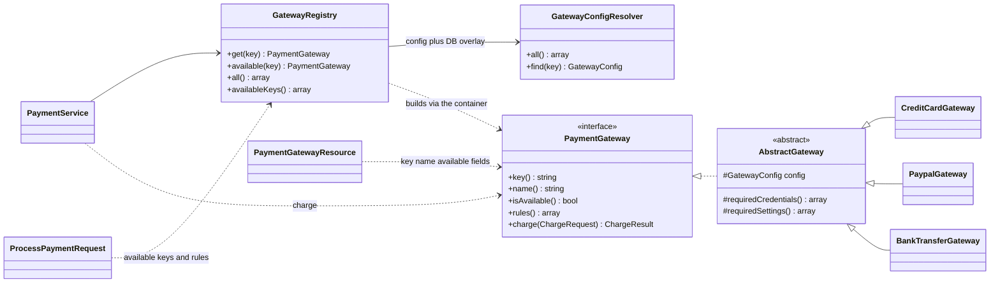

# Order OS

An extendable order and payment management API. You create orders, confirm
them, and take payment through pluggable gateways. The point of the exercise is
the last part: **adding a payment gateway means writing one class, adding one
config block and setting its `.env` keys, with no changes anywhere else.**
[`docs/ADDING_A_PAYMENT_GATEWAY.md`](docs/ADDING_A_PAYMENT_GATEWAY.md) walks
through it end to end.

It's a Laravel 13 modular monolith on DDEV. It shares its architecture with the
sibling products ([Wealth OS](../wealth-os), [Clinic OS](../clinic-os)):
nwidart modules, repositories behind interfaces bound in module providers,
services, DTOs, and one `ModuleServiceProvider` base in Core. It departs from
them in three places, each for a reason: see *Where this departs from the
siblings*.

Architecture in one page: [`docs/ARCHITECTURE.md`](docs/ARCHITECTURE.md).

---

## Running it

### With DDEV (recommended)

```sh
ddev start
ddev composer install
cp .env.example .env
ddev artisan key:generate
ddev artisan jwt:secret
ddev artisan migrate --seed
```

The API is at `https://order-os.ddev.site/api/v1`. `GET /` returns a
small JSON pointer to it, and `GET /up` is the health check.

`.env.example` already carries DDEV's database credentials and sandbox values
for all three bundled gateways, so nothing else needs editing to try every
payment path.

### Without DDEV

You need PHP 8.3 (with `pdo_mysql` or `pdo_sqlite`, `mbstring`, `openssl`),
Composer 2, and either MySQL 8 or SQLite.

```sh
composer install
cp .env.example .env
php artisan key:generate
php artisan jwt:secret
```

Then point `.env` at a database:

- **MySQL**: set `DB_HOST`, `DB_PORT`, `DB_DATABASE`, `DB_USERNAME` and
  `DB_PASSWORD` to your server. The DDEV defaults (`db`/`db`/`db`) won't
  resolve outside the container.
- **SQLite**: set `DB_CONNECTION=sqlite`, delete the other `DB_*` lines
  (otherwise `DB_DATABASE=db` is read as a file path), and create the file:
  `touch database/database.sqlite`.

```sh
php artisan migrate --seed
php artisan serve          # http://127.0.0.1:8000/api/v1
```

Set `APP_URL=http://127.0.0.1:8000` to match. On SQLite the order row lock
used by payments (`SELECT … FOR UPDATE`) is a no-op. SQLite serialises
writes anyway, so the guarantees hold for a single-machine demo. Run MySQL for
anything concurrent.

### Seeded data

Password for both accounts: `password123`.

| Email | What it has |
|---|---|
| `demo@order-os.test` | Four orders, one in each state, and a payment history |
| `other@order-os.test` | Nothing |

The second account is there on purpose, as the canary for scope leaks. Log
in as `other@order-os.test` and request any of the demo user's order or
payment ids: every one must answer `404`. An endpoint that leaks one person's
orders to another fails visibly in the demo data rather than in production.

The demo user's orders, built through `OrderService` so that totals and
timestamps are exactly what the API would have produced:

| # | Status | Customer | Total | Payments |
|---|---|---|---|---|
| 1 | pending | Jane Doe | 119.90 | none (it's a draft, so edit it) |
| 2 | confirmed | John Smith | 45.00 | a declined card, then a successful retry |
| 3 | confirmed | John Smith | 249.99 | none, left unpaid for you to pay |
| 4 | cancelled | Ana Lopez | 59.00 | none |

Order 2 shows the retry-after-decline path in its history. Order 3 is the one
to pay from Postman or curl. The seeders are idempotent. To get back to this
exact state, run `ddev artisan migrate:fresh --seed`.

### Tests

```sh
ddev exec ./vendor/bin/phpunit                      # every suite: 407 tests, 1391 assertions
ddev exec ./vendor/bin/phpunit --testsuite=Modules  # module tests: where the real tests live
ddev artisan test                                   # same thing, Laravel's runner
```

Module tests live in `Modules/<Module>/tests/{Unit,Feature}`. The root
`Unit` and `Feature` suites exist for anything that genuinely belongs to the
application shell rather than a module. Tests run on in-memory SQLite with a
fixed JWT secret and sandbox credentials for every gateway, all set in
`phpunit.xml`. They need no database server and make no network calls.

Formatting: `ddev exec ./vendor/bin/pint`.

### Postman

Import both files into Postman:

- `docs/postman/Order-OS.postman_collection.json`: the collection, **Order OS API**
- `docs/postman/Order-OS.postman_environment.json`: the environment, **Order OS — local (DDEV)**

Select the environment, then run **Authentication → Login** first. It stores
the token in a collection variable that every other request uses. Each request
has saved example responses, including the error cases.

From the command line (the DDEV certificate is local, hence `-k`):

```sh
postman collection run docs/postman/Order-OS.postman_collection.json \
  -e docs/postman/Order-OS.postman_environment.json -k
```

The run is 47 requests. The collection creates its own orders and pays them, so re-seed afterwards if
you want the table above back.

The examples are not hand-written. `docs/postman/generate.php` sends every
request in the collection through the real HTTP kernel, in order, against a
throwaway in-memory SQLite database, and saves what came back as that
request's example — so the documentation cannot drift from the code. After
changing an endpoint, regenerate it:

```sh
ddev exec php docs/postman/generate.php
```

Every request also asserts its status code (and error `code`), so a run of the
collection is a contract test against a live server.

---

## Stack

Laravel 13 · PHP 8.3 · MySQL 8.0 · nwidart/laravel-modules 13 ·
php-open-source-saver/jwt-auth 2 · PHPUnit 12 · DDEV.

No Sanctum, no Passport, no Redis, no queue workers needed, no frontend. See
*What is deliberately not here*.

---

## Module layout

| Prio | Module | What it owns |
|---|---|---|
| 0 | Core | Base model, repository, service, DTO, controller and form request; the JSON error renderer; `Money`; the versioned route mounting; the API rate limiter |
| 1 | Auth | Users, registration, the JWT lifecycle (issue, refresh, revoke), the login rate limiter |
| 2 | Orders | Orders and items, the status machine, totals, the `OrderPaymentInspector` seam |
| 3 | Payments | Payments, the `PaymentGateway` contract, the registry, config resolution, the three bundled gateways, the `payments:gateway` command |

Dependencies only point downward: Payments → Orders → Auth → Core. The one
place Orders needs to know about payments (refusing to delete an order that
has them) goes through a contract that Orders owns and Payments implements.
See [`docs/ARCHITECTURE.md`](docs/ARCHITECTURE.md).

Each module has the same shape:

```text
Modules/Payments/
  app/
    Console/        artisan commands
    Contracts/      interfaces other code depends on
    DTOs/           typed data crossing a layer boundary
    Enums/
    Events/
    Exceptions/     one class per module, every code in one place
    Gateways/       (Payments only) the strategies
    Http/{Controllers,Requests,Resources}
    Models/
    Providers/      binds repositories to their interfaces
    Repositories/{Contracts/,*.php}
    Services/
  config/config.php
  database/{factories,migrations,seeders}
  lang/en/
  routes/api.php
  tests/{Unit,Feature}
```

### Layering rules

- **Controllers are thin.** A form request validates and builds a DTO, a
  service applies the rules, an API resource shapes the response. No
  controller touches Eloquent.
- **Services own business rules.** Anything that spans more than one model,
  needs a transaction or fires an event lives in a service, never in a
  controller or a form request.
- **Repositories own data access.** Services ask a repository and never build
  a query. Every repository has an interface in `Repositories/Contracts`, and
  the module provider binds it.
- **DTOs cross boundaries.** A form request's `toData()` produces a DTO, and
  the service consumes it. A renamed request field can't silently break a
  service.
- **Every error is a stable code.** Each module throws its own subclass of
  `Modules\Core\Exceptions\DomainException`, and Core renders all of them to
  the same JSON without knowing a single module by name.
- **Every module provider extends `Modules\Core\Providers\ModuleServiceProvider`.**
  nwidart's generator stub points at its own base, which registers a module's
  `lang/` directory without a namespace, so `orders::errors.*` keys come back
  as raw keys. Repointing it is the first edit after `module:make`.
- **Every module's routes are mounted by `ModuleRouteServiceProvider`** under
  `api/v1` with the `api.v1.` name prefix. Bumping to v2 is one constant.

### Where this departs from the siblings

The siblings are Filament apps. This is an HTTP API, and three of their rules
don't survive that change:

- **Form Requests and API Resources are used.** The siblings forbid both
  because Filament schemas do validation and rendering. Here the HTTP request
  *is* the interface. A form request is the natural place to validate it and
  build a DTO, and a resource is the natural place to fix the response shape.
  `ApiFormRequest::authorize()` returns `true` on purpose: every repository
  scopes by user, so a per-request `authorize()` would be a second, weaker
  copy of that rule.
- **JWT, not sessions.** A stateless API carries its credentials on every
  request. The `api` guard is the default guard and uses the `jwt` driver.
- **Module factories exist.** The siblings build test fixtures through real
  services. Here `User`, `Order` and `Payment` have factories, because
  payment tests need orders in specific states (confirmed, paid, with a
  pending transfer) and getting there through the HTTP flow every time would
  bury the assertion. The seeders still go through the services.

---

## Request lifecycle

What `POST /api/v1/orders/3/payments` passes through:

1. **`ForceJsonResponse`** (prepended to the `api` group) sets
   `Accept: application/json`. Without it, a curl request with no Accept header
   that fails validation gets the web behaviour, a 302 to `/`.
2. **`auth:api`** checks the bearer token against the JWT guard. A missing,
   expired or revoked token gets `401 unauthenticated`.
3. **`throttle:api`** applies the per-user limit.
4. **`ProcessPaymentRequest`** validates the common fields, then merges in the
   chosen gateway's own `rules()` under `details.*`. It also checks the
   `Idempotency-Key` header's format. Failures get `422` with `errors`.
5. **`OrderPaymentController::store`** loads the order *through the user's
   scope* (someone else's order is a `404`) and hands it to
   `PaymentService::process` along with the DTO.
6. **`PaymentService`** replays an idempotent retry if there is one. Otherwise
   it locks the order, checks the rules, records a pending payment, calls the
   gateway outside the transaction, records the outcome and fires events.
7. **`PaymentResource`** shapes the body. The controller picks the status
   (201, 402 or 200), and Core's renderer turns any `DomainException` into
   `{ message, code, context }`.

---

## API overview

Base URL: `/api/v1`. Every endpoint except register and login needs
`Authorization: Bearer <token>`.

### Auth

| Method | Path | Purpose | Success |
|---|---|---|---|
| POST | `/auth/register` | Create an account and get a token | 201 |
| POST | `/auth/login` | Exchange email and password for a token | 200 |
| GET | `/auth/me` | The authenticated user | 200 |
| POST | `/auth/refresh` | Swap the current token for a new one (the old one is revoked) | 200 |
| POST | `/auth/logout` | Revoke the current token | 204 |

### Orders

| Method | Path | Purpose | Success |
|---|---|---|---|
| GET | `/orders` | Your orders, newest first. `?status=`, `?per_page=`, `?page=` | 200 |
| POST | `/orders` | Create a draft (`pending`) order. Sets a `Location` header | 201 |
| GET | `/orders/{id}` | One order with its items | 200 |
| PATCH | `/orders/{id}` | Partial update: details, items and/or status. `PUT` is not offered (`405`) | 200 |
| DELETE | `/orders/{id}` | Delete an order that has no payments | 204 |

### Payments

| Method | Path | Purpose | Success |
|---|---|---|---|
| POST | `/orders/{id}/payments` | Pay a confirmed order with a gateway | 201 (paid or pending), 402 (declined), 200 (idempotent replay); 502 if the gateway threw |
| GET | `/orders/{id}/payments` | One order's payment attempts. `?status=`, `?method=` | 200 |
| GET | `/payments` | All your payments. `?status=`, `?method=`, `?order_id=` | 200 |
| GET | `/payments/{id}` | One payment | 200 |

### Gateways

| Method | Path | Purpose | Success |
|---|---|---|---|
| GET | `/payment-gateways` | Every configured gateway: key, name, availability, and the `details` fields it expects | 200 |

`{id}` segments are constrained to digits, so `/orders/abc` gets
`404 route_not_found` rather than a type error.

A payment request looks like this. The client names an order and a method,
never an amount:

```http
POST /api/v1/orders/3/payments
Authorization: Bearer eyJ0eXAiOiJKV1Qi...
Content-Type: application/json
Idempotency-Key: 6f1c2a3e-checkout-3

{
  "method": "credit_card",
  "details": {
    "card_number": "4242 4242 4242 4242",
    "exp_month": 12,
    "exp_year": 2030,
    "cvc": "123"
  }
}
```

```json
{
  "data": {
    "id": 3,
    "order_id": 3,
    "method": "credit_card",
    "status": "successful",
    "amount": "249.99",
    "currency": "USD",
    "transaction_id": "ch_CJCXNCXCDWNNMHPCFRYQX5MZ",
    "failure": null,
    "details": { "mode": "sandbox", "card_brand": "visa", "card_last4": "4242" },
    "processed_at": "2026-10-20T06:27:37+00:00",
    "created_at": "2026-10-20T06:27:37+00:00",
    "updated_at": "2026-10-20T06:27:37+00:00"
  }
}
```

`details` in the response is what the gateway chose to keep (brand and last
four, never the number). `failure` is `{ code, message }` on a declined
payment and `null` otherwise.

---

## Responses and errors

Successful responses are wrapped in `data`. Lists add `links` and `meta`.
Amounts are **strings with two decimals** (`"249.99"`), not JSON numbers,
because a JSON number is a float to most clients. Timestamps are ISO 8601.

Errors come in exactly two shapes.

**Validation (422)** keeps Laravel's own body, which every client library
already understands:

```json
{
  "message": "The customer name field must be at least 2 characters. (and 1 more error)",
  "errors": {
    "customer_name": ["The customer name field must be at least 2 characters."],
    "items": ["An order needs at least one item."]
  }
}
```

**Everything else** is `{ message, code }`, plus `context` when there is
something machine-readable to add:

```json
{
  "message": "An order cannot move from cancelled to pending.",
  "code": "invalid_status_transition",
  "context": { "from": "cancelled", "to": "pending", "allowed": [] }
}
```

**Branch on `code`, never on `message`.** The code is the contract. The
message is for people and may be reworded at any time.

### Error codes

| Code | HTTP | Raised when | `context` |
|---|---|---|---|
| `unauthenticated` | 401 | No token, or an expired, malformed or revoked one | — |
| `invalid_credentials` | 401 | Login with an unknown email *or* a wrong password (one message for both, so login can't be used to discover accounts) | — |
| `resource_not_found` | 404 | The id doesn't exist **or belongs to another user**. The model name is never echoed | — |
| `route_not_found` | 404 | No such endpoint | — |
| `method_not_allowed` | 405 | Wrong HTTP verb for the endpoint | — |
| `order_not_editable` | 409 | Changing details or items of an order that is no longer `pending` | `status` |
| `invalid_status_transition` | 422 | A status change the state machine forbids | `from`, `to`, `allowed` |
| `order_has_payments` | 409 | Deleting an order that has any payment, failed ones included | — |
| `order_already_paid` | 409 | Paying an order that has a successful payment, **or** cancelling one | `payment_id` (when paying) |
| `order_not_confirmed` | 409 | Paying a `pending` or `cancelled` order | `order_status` |
| `payment_in_progress` | 409 | Paying, or cancelling, an order that has a `pending` payment | `payment_id` (when paying) |
| `idempotency_key_reused` | 422 | An `Idempotency-Key` already used for a *different* order | — |
| `gateway_unreachable` | 502 | The gateway provably never sent the charge (connection refused, DNS, TLS handshake, open circuit breaker). The attempt is `failed`, the Idempotency-Key is released, and a retry is safe | `payment_id`, `payment_status: "failed"` |
| `gateway_error` | 502 | The gateway threw anything else, a timeout above all: **the outcome is unknown**. The attempt stays `pending` until reconciled, and **you must not pay again** | `payment_id`, `payment_status: "pending"` |
| `unsupported_payment_method` | 422 | Backstop: no gateway configured under that key | `available_methods` |
| `payment_method_unavailable` | 422 | Backstop: the gateway is switched off or missing credentials | `available_methods` |
| `too_many_requests` | 429 | A rate limit was hit. `Retry-After` and `X-RateLimit-*` headers say when to come back | — |
| `server_error` | 500 | Anything unexpected, when `APP_DEBUG=false`. The exception is logged; nothing about it is returned | — |
| *(none)* | 422 | Validation failed. See `errors` | — |

The two backstop codes are raised by `GatewayRegistry`. Over HTTP the form
request catches an unknown or unavailable `method` first, as a validation
error on `method` that lists the available keys. The domain codes protect
callers that skip the form request: seeders, jobs, tinker.

A **declined payment is not an error.** It answers `402` with the payment
itself as the body (`status: "failed"`, `failure.code` set), so the client
always has the id of the attempt. Failure codes the bundled gateways produce:
`card_declined`, `insufficient_funds`, `expired_card`, `payer_declined`, and
`gateway_unreachable` when the charge provably never left. A payment whose
outcome is unknown is not failed: it stays `status: "pending"` with
`failure.code: "gateway_error"` (see *Gateway errors* below).

### Pagination

Every list takes `per_page` (1–100, default 15) and `page`. It returns
Laravel's standard paginator envelope:

```json
{
  "data": [ ... ],
  "links": { "first": "...?page=1", "last": "...?page=2", "prev": null, "next": "...?page=2" },
  "meta": { "current_page": 1, "from": 1, "last_page": 2, "per_page": 2, "to": 2, "total": 4, "path": "...", "links": [ ... ] }
}
```

Filters are validated, so `?status=paid` is a `422` that lists the valid
values rather than an empty list. Pagination links keep the query string.

---

## Authentication

- **JWT (HS256)** signed with `JWT_SECRET`, which `artisan jwt:secret`
  writes. `register` and `login` return
  `{ access_token, token_type: "bearer", expires_in, user }`.
- **Lifetime**: `JWT_TTL` minutes (60 by default, so `expires_in: 3600`
  seconds).
- **Refresh**: `POST /auth/refresh` with a current token returns a new one.
  Refreshing is allowed for `JWT_REFRESH_TTL` minutes (20160, 14 days) from
  when the token was first issued.
- **Revocation**: refresh and logout both add the old token to the
  blacklist (`JWT_BLACKLIST_ENABLED=true`), with no grace period. A stolen
  token can't be refreshed into a second live one. The blacklist lives in the
  cache store (`CACHE_STORE=database`, the `cache` table), so **clearing the
  cache un-revokes tokens** until they expire on their own.
- **Registration**: `password` needs 8+ characters with letters and numbers,
  plus `password_confirmation`. Emails are trimmed and lowercased on both
  register and login. A taken email is a `422` on `email`, and that includes
  two registrations racing for one address: the loser of the unique index gets
  the same `422`, not a `500`.

### Rate limits

| Limiter | Applies to | Limit | Keyed by |
|---|---|---|---|
| `auth` | `register`, `login` | `AUTH_LOGIN_ATTEMPTS_PER_MINUTE` (10)/min **and** 3× that (30)/min | email, and IP, respectively |
| `api` | every orders, payments and gateways route | `API_RATE_LIMIT` (60)/min | user id once authenticated, IP before |

The auth limiter is keyed twice so that one address guessed from many
machines and one machine guessing many addresses both hit a wall. The API
limiter is per user so that an office behind one NAT doesn't share one
budget. Responses carry `X-RateLimit-Limit` and `X-RateLimit-Remaining`. Over
the limit you get `429` with `Retry-After`. `me`, `refresh` and `logout` are
not throttled.

---

## Business rules

### Orders

```text
pending ──► confirmed ──► cancelled
   │                         ▲
   └─────────────────────────┘
```

- **Created as `pending`**, always. Sending `status` or `total` on create is
  refused (`422`), not silently ignored: a client that sends a status believes
  it is setting one. The currency is `ORDER_CURRENCY` (USD by default).
- **Items**: 1–100 per order. Each item takes exactly `product_name`,
  `quantity` (1–10000) and `price` (0.01–999999.99, at most two decimals).
  Unknown keys inside an item are rejected. The order total may not exceed
  `9999999999.99`, the `DECIMAL(12,2)` limit (`422` on `items`). The price is copied onto the line,
  because an order records what the customer agreed to pay, whatever the
  product costs tomorrow.
- **Totals are computed, never accepted.** `line_total = price × quantity`,
  `total = Σ line_total`, in integer cents. `total` is `prohibited` on create
  and update.
- **Updates are `PATCH` only**: a partial update. `PUT` promises a full
  replacement that this endpoint doesn't do, so it isn't routed and answers
  `405 method_not_allowed`. Only fields sent
  are changed, and `items`, when sent, replaces the whole list. An update that
  changes nothing (`{}`, or a misspelt field) is refused with a `422` on
  `body`, because it is almost always a client bug. Sending `customer_phone`
  or `notes` as `null` clears it, and leaving it out leaves it alone.
- **Only `pending` orders are editable.** Confirming locks the items and the
  total, because that total is what a payment will charge. Details and a
  status change may arrive together: the details are checked against the
  status *before* the change. So *fix the email and confirm* works on a
  draft, but a confirmed order can't be edited by sending a status alongside
  the edit (`409 order_not_editable`).
- **Transitions**: pending → confirmed, pending → cancelled,
  confirmed → cancelled. Cancelled is terminal. Anything else is
  `422 invalid_status_transition`, and its context lists the allowed targets.
  Sending the status the order already has is a no-op.
- **A paid order can't be cancelled** (`409 order_already_paid`). That would
  need a refund flow, which is out of scope. Nor can one with a **pending**
  payment (`409 payment_in_progress`): a bank transfer that lands on a
  cancelled order is a refund nobody is expecting.
- **Deletion is refused once any payment exists**, failed ones included
  (`409 order_has_payments`). A declined charge is still a record the gateway
  holds, and deleting the order would leave it pointing at nothing. The
  `payments.order_id` foreign key is `RESTRICT`, so the database enforces the
  same rule underneath the service.
- **Edits, cancellations and deletes take the order's row lock**, the same
  `SELECT … FOR UPDATE` a payment takes, and check their rules under it. A
  cancel, edit or delete can't race a payment being opened: one waits for the
  other and sees its result.
- **Events**: `OrderCreated`, `OrderUpdated`, `OrderStatusChanged`
  (`from` and `to`), `OrderDeleted` (ids only, because the row is gone). Nothing
  listens yet. They are the hook points for notifications and fulfilment.

### Payments

- **Only `confirmed` orders take payment.** Pending (a draft whose total may
  still change) and cancelled orders get `409 order_not_confirmed`.
- **The amount is never the client's.** `amount` is `prohibited` in the
  request. The charge is the order's `total` and `currency`, read under the
  row lock.
- **One payment in flight, one success.** A `successful` payment blocks any
  further payment (`order_already_paid`). So does a `pending` one
  (`payment_in_progress`): a bank transfer awaiting confirmation may still
  land, and charging a card on top of it would take the money twice.
- **Retry after failure.** A `failed` payment (a decline, or
  `gateway_unreachable`) blocks nothing. Every attempt is
  its own row, so an order's history shows the decline and the retry that
  succeeded.
- **Status codes**: `201` (with `Location`) when the payment is `successful`
  or `pending`; `402` when the gateway declined, with the failed payment as
  the body; `200` with `Idempotent-Replayed: true` when an
  `Idempotency-Key` is replayed; `502` when the gateway threw.
- **Gateway errors: "never sent" versus "don't know".** Either way the exception
  is reported and the client gets `502` with `payment_id` and `payment_status`
  in `context`. What happens to the payment depends on which it was:
  - **`gateway_unreachable`**: the gateway threw `GatewayUnreachable`, meaning
    the request provably never left. No money can have moved, so the payment
    becomes `failed`, its Idempotency-Key is released (a retry with the same
    key is a fresh attempt), and `PaymentFailed` fires. Retry at once.
  - **`gateway_error`**: anything else the gateway threw, a timeout above all.
    The vendor may have captured the money and failed to say so, and marking
    the payment failed would let a retry charge the customer twice. So it
    **stays `pending`** with `failure.code = gateway_error` and
    `processed_at = null`. It keeps its Idempotency-Key (a same-key retry
    replays it with `200`), blocks new payments (`409 payment_in_progress`)
    and cancellation, and fires no `PaymentFailed`. Reconciliation or a webhook
    settles it, and neither is built here.
- **Idempotency.** Send `Idempotency-Key` (8–255 chars of `A-Z a-z 0-9 _ - : .`)
  and a repeated request returns the original payment and charges nothing.
  Keys are scoped per user (a unique index on `user_id, idempotency_key`).
  - A replay returns the original payment **whatever the new body says**. A
    different method or card makes no difference. The body must still pass
    validation.
  - A key first used for one order and sent again for another is
    `422 idempotency_key_reused`. That is a client bug, caught rather than
    answered with the wrong order's payment.
  - Replaying a *declined* attempt returns that declined payment with `200`.
    **To retry after a decline, send a new key.**
  - Two simultaneous requests with one key: the key is checked again under
    the order's row lock, so the one that waits gets the winner's payment as
    a replay (`200`), not a `409`. The unique index on the key backs that up.
- **Concurrency**: the checks and the pending row are written under
  `SELECT … FOR UPDATE` on the order, so two simultaneous payments for one
  order queue and the second sees the first's pending row. The gateway call
  happens **after** that transaction commits, because a slow vendor must not
  hold a database lock open for seconds.
- **Events**: `PaymentProcessed` on every outcome, plus `PaymentSucceeded` or
  `PaymentFailed`. A pending result fires only `PaymentProcessed`.
  `processed_at` stays `null` until a payment settles.

---

## Money

Amounts are stored as `DECIMAL(12,2)` and travel as two-decimal strings.
Every sum and product is done in **integer minor units** through
`Modules\Core\Support\Money` (`toMinor`, `fromMinor`, `normalize`). In
floating point 0.1 + 0.2 is not 0.3, and an order total that is off by a cent
is an order the gateway charges differently from what the customer was shown.
Three pens at `0.10` and a pad at `0.20` total exactly `"0.50"`.

There is one currency per order, fixed at creation from `ORDER_CURRENCY`, and
the payment copies it. There is no conversion. Gateways receive the amount as
a decimal string and convert to whatever their vendor wants: the Stripe
example in the guide sends `Money::toMinor($amount)` cents.

---

## Payment gateways: the extensibility story

### The shape

It's the **strategy pattern**. `PaymentGateway` is the strategy,
`PaymentService` is the context, and `GatewayRegistry` picks the strategy for
the `method` the client sent.



**Nothing outside a gateway class knows how any particular gateway works.**
`PaymentService` never names one. It enforces the rules every payment
shares and then calls `charge()` on whatever the registry returns. The HTTP
layer asks the gateway itself which `details` fields it needs.

### How a gateway gets built

1. **`config('payments.gateways')`** (`Modules/Payments/config/config.php`)
   has one entry per gateway. The array key is the `method` clients send.
   Each entry has a `driver` class, a display `name`, an `enabled` flag,
   `credentials` (secrets, all from `.env`) and `settings` (non-secret
   options).
2. **`GatewayConfigResolver`** lays the `payment_gateway_settings` row with
   the same key (if any) over that entry, and produces one immutable
   `GatewayConfig` per gateway.
3. **`GatewayRegistry::get($key)`** calls
   `$container->make($driver, ['config' => $gatewayConfig])`. The gateway's
   own config is passed **by parameter name**. Everything else its
   constructor type-hints (an HTTP client, a logger, a vendor SDK) is
   resolved by the container. No factory and no `match ($key)` exist anywhere.
4. A driver that doesn't implement `PaymentGateway` throws a `LogicException`.
   A misconfigured driver is a deploy bug, not a `422` the client can't fix.

The resolver and the registry are bound `scoped`: one resolved config and one
set of gateway instances per request or job, so listing gateways and then
charging one reads the settings table once.

**Availability** is `enabled` *and* every name in `requiredCredentials()` and
`requiredSettings()` present and non-blank. A gateway switched on but missing
its API key in this environment is reported as `available: false` and
refused at validation, instead of failing at charge time.

### What a new gateway shows up in, automatically

As soon as its config block exists, without another line of code:

- `GET /payment-gateways` lists it with its key, name, availability and the
  `details` fields derived from its `rules()`.
- `POST /orders/{id}/payments` accepts it as a `method` (while it is
  available) and validates `details.*` with its `rules()`. Error messages read
  `card number`, not `details.card_number`, derived from the field names, so a
  new gateway needs no lang entry for them.
- `GET /payments?method=` accepts its key. Every *configured* key counts here,
  not just available ones, because a gateway switched off today still has
  yesterday's payments.
- `php artisan payments:gateway <key>` can switch it and rotate its keys.

### Configuration: `.env` first, database on top

`.env` and the config file are the seed. A row in `payment_gateway_settings`
overrides them per key, so you can switch a gateway off or rotate a key
without a deploy:

```sh
ddev artisan payments:gateway paypal --disable
ddev artisan payments:gateway credit_card --credential=secret_key=sk_live_...
ddev artisan payments:gateway bank_transfer --setting=iban=DE89370400440532013000
ddev artisan payments:gateway paypal --enable
ddev artisan payments:gateway paypal --reset      # drop the override; .env applies again
```

- `enabled` is nullable. `null` means "not overridden", which is different
  from "switched off".
- Credentials and settings merge **per name** (`array_replace`). A row that
  rotates only `secret_key` keeps `public_key` from `.env`. The command also
  merges new pairs into whatever the row already holds.
- `credentials` are stored with the `encrypted:array` cast (APP_KEY) and
  hidden from serialisation. A database dump is not a list of live secrets.
- **The `driver` class can only come from the config file.** A database row
  that could name an arbitrary class would be a remote-code-execution switch.

### The bundled gateways

All three are **simulations** shaped like their vendor's sandbox. They make
no network calls, and deterministic magic values produce each outcome, so
every path can be exercised from Postman.

| Key | `details` fields | Magic values → outcome | Kept in `details` | Needs |
|---|---|---|---|---|
| `credit_card` | `card_number` (Luhn-checked), `exp_month`, `exp_year`, `cvc`, `holder_name`? | `4242 4242 4242 4242` → successful · `4000 0000 0000 0002` → failed `card_declined` · `4000 0000 0000 9995` → failed `insufficient_funds` · expiry month already past → failed `expired_card` · any other Luhn-valid number → successful | `card_brand`, `card_last4`, `mode` | `public_key`, `secret_key` |
| `paypal` | `paypal_email` | an email starting with `declined` (e.g. `declined@example.com`) → failed `payer_declined` · anything else → successful (`PAYID-…`) | `payer_email` masked (`j***@example.com`), `mode` | `client_id`, `client_secret` |
| `bank_transfer` | `account_holder`? | always **pending**, with reference `ORD-{order}-PAY-{payment}` | `account_holder` when sent, and `instructions`: beneficiary, bank name, IBAN, amount, currency, reference | setting `iban` |

The bank transfer is there to prove the contract handles more than "charge
and know at once". It is why the third payment status exists. It stays
`pending` until something settles it, which is out of scope here (see below).

`.env.example` ships placeholder credentials for all three. Because they are
simulations, any non-empty value makes them available.

### Adding one

Exactly these, and nothing else:

| You touch | What |
|---|---|
| `Modules/Payments/app/Gateways/YourGateway.php` | One class: `rules()`, `charge()`, `requiredCredentials()` |
| `Modules/Payments/config/config.php` | One block under `gateways` |
| `.env` / `.env.example` (and `phpunit.xml` for tests) | Its keys |

These are never touched: `PaymentService`, the controllers, the form
requests, the resources, the routes, the migrations, the registry, the
service provider.

**→ [`docs/ADDING_A_PAYMENT_GATEWAY.md`](docs/ADDING_A_PAYMENT_GATEWAY.md)**
is a full tutorial. It adds a real-shaped Stripe gateway over Laravel's HTTP
client, with tests, a checklist and the contract rules every gateway must
keep.

---

## Security notes

- **No card data is stored.** The full number and the CVC exist only for the
  length of `charge()`. Only the brand and last four are kept, and PayPal
  emails are masked. The database is not in PCI scope.
- **Gateway credentials are encrypted at rest** in
  `payment_gateway_settings`, and no credential or setting is ever returned
  by the API. Because they are encrypted with `APP_KEY`, rotating the key
  needs `APP_PREVIOUS_KEYS` set, or the stored credentials become unreadable.
- **The driver class comes only from config**, never from the database or a
  request.
- **Everything is scoped by user** in the repositories: `ownedBy($userId)` on
  every order and payment query. Another user's order or payment is
  indistinguishable from one that doesn't exist (`404 resource_not_found`,
  with no model name in the message). Idempotency keys are per user too.
- **The client never sends money.** The amount is the order's total, read
  under a lock. `amount` and `total` are `prohibited`.
- **Throttling** on login and registration (per email and per IP) and on
  every authenticated route (per user).
- **Login doesn't reveal accounts**: one message for an unknown email and a
  wrong password.
- **Revocable tokens**: logout and refresh blacklist the old token.
- **No HTML responses** from the API. `ForceJsonResponse` and the renderer
  make sure an error never turns into a redirect or a web page.

---

## Assumptions and decisions

- **Full payment only.** An order is paid in one successful payment of its
  whole total. Partial payments and split tenders are not modelled.
- **No refunds.** That is why a paid order can't be cancelled: a cancelled
  order with money taken and nobody owed anything is worse than a refused
  request.
- **Confirmed orders are locked.** Confirmation fixes the total that a
  gateway will charge. To change a confirmed order, cancel it and create a
  new one.
- **Pending payments settle later.** A bank transfer, and any charge whose
  gateway call ended in an unknown outcome (`gateway_error`), stays `pending`
  until a bank webhook or a reconciliation job moves it to `successful` or
  `failed`. Neither is built. Until then the pending payment blocks further
  payment and cancellation on its order, which is the price of never charging
  twice.
- **One currency per order**, from `ORDER_CURRENCY` at creation. No FX.
- **Gateways are simulated.** Each bundled gateway is a deterministic stand-in
  with the real integration's shape. Replacing the body of `charge()` with a
  vendor call is the whole change. The guide shows one.
- **The customer is data, not a user.** An order belongs to the authenticated
  *user* (the merchant or operator calling the API). `customer_name` and
  `customer_email` describe who it's for. There are no roles or admin users:
  every user sees only their own orders.
- **Any status may be deleted**, provided no payment exists. A draft,
  confirmed-but-unpaid or cancelled order with no payment history leaves
  nothing behind.

---

## What is deliberately not here

Each of these is an absence by choice, with a sketch of where it would go:

- **Webhooks / settlement.** A `POST /webhooks/{gateway}` route, an optional
  `WebhookHandler` interface that a gateway can implement, and a
  `PaymentService::settle()` that moves a pending payment and fires the same
  events. It's needed by bank transfers, 3-D Secure, and the `gateway_error`
  payments left pending by a timeout, which a reconciliation job would settle
  by asking the vendor what really happened.
- **Refunds.** A `refund()` capability as its own interface, so gateways that
  can't refund don't have to pretend. It would add a `refunded` payment
  status and let cancellation of paid orders go through it.
- **Partial payments.** Payments would sum toward the total, and "paid" would
  become a computed property rather than "has one successful payment".
- **An admin API for gateway settings.** Today it's the `payments:gateway`
  artisan command. An HTTP version needs roles first.
- **OpenAPI.** The Postman collection is the executable reference. An
  OpenAPI document generated from the form requests and resources would be
  the next step for client SDKs.
- **Roles and permissions.** There is one kind of user. The siblings'
  spatie/laravel-permission setup would slot in at `ApiFormRequest::authorize()`.
