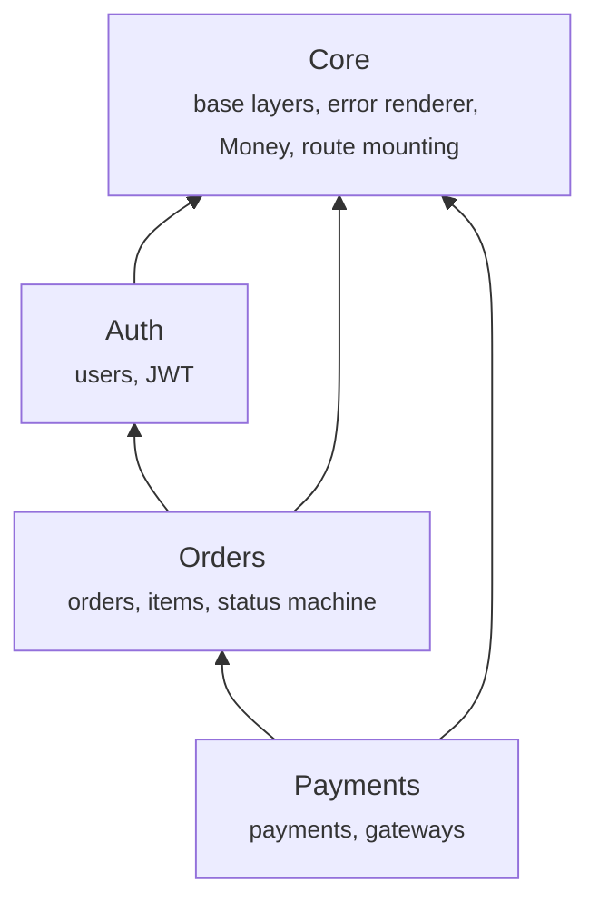
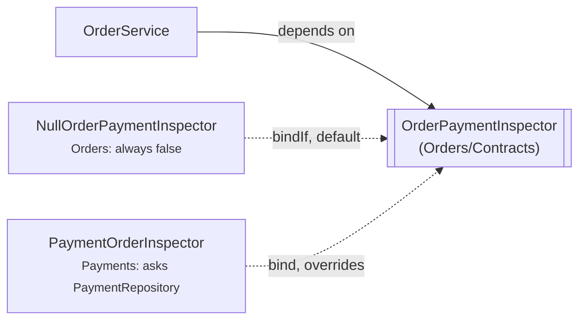
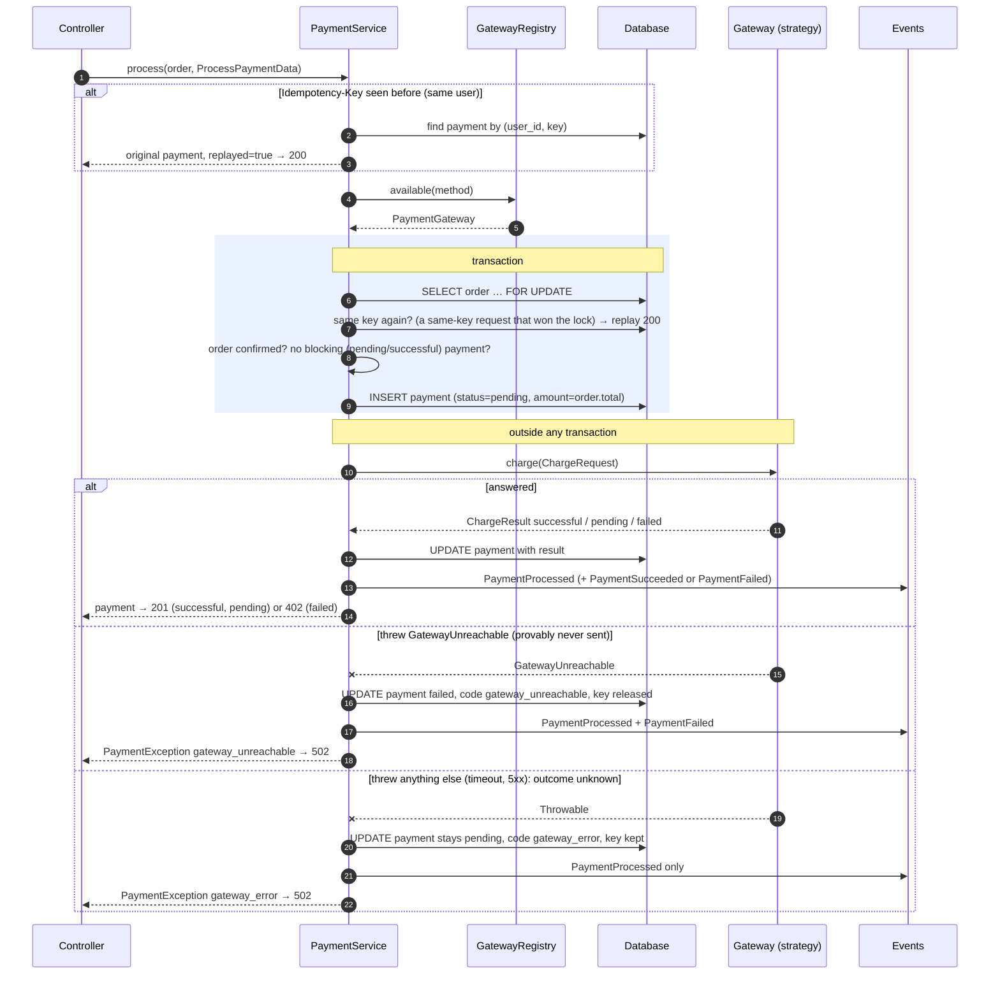

# Architecture

This page covers the shape of the system on one page: how the modules depend
on each other, what happens during a payment, and which patterns are used
where. Setup, the API and the business rules are in the
[README](../README.md).

---

## Module dependencies

Arrows point at what a module imports. **Imports only go downward**, in boot
order (`priority` 0–3 in each `module.json`):

- **Core** knows no module. The renderer handles any `DomainException`
  subclass without naming one.
- **Auth** uses Core's bases.
- **Orders** uses `User` for the `belongsTo` relation.
- **Payments** uses Orders' `Order` model, `OrderStatus` enum and
  `OrderService`. It asks the service for an order and a row lock, and never
  queries the `orders` table itself.

### The one upward question, and its seam

Orders has to answer two questions that depend on payments: *can this order
be deleted?* (not if it has any payment) and *can it be cancelled?* (not if it
has a successful or a pending one). The contract has one method per fact:
`hasPayments()`, `hasSuccessfulPayment()`, `hasPendingPayment()`. Importing Payments to find out would point an arrow
upward, so Orders owns a contract instead:

- `OrdersServiceProvider` registers the null implementation with `bindIf`:
  no payments module, no payments.
- `PaymentsServiceProvider` (which registers later, at priority 3) rebinds the
  interface to `PaymentOrderInspector`, which asks `PaymentRepository`.
- That is what lets Orders stand alone: with Payments switched off in
  `modules_statuses.json`, the null default answers and there is nothing to refuse.

The same rule (the lower module defines the interface and the higher one
implements it) is how any future cross-module question should be answered.

---

## A payment, step by step

`POST /api/v1/orders/{id}/payments` → `OrderPaymentController::store` →
`PaymentService::process()`:

Why this order:

1. **Lock, then decide.** Two simultaneous payments for one order queue on the
   row lock. The second sees the first's *pending* row and is refused with
   `payment_in_progress`, so the check and the insert can't interleave.
2. **Write the pending row before calling the gateway.** The attempt exists
   before any money moves, so a crash mid-call leaves a pending row to
   reconcile rather than a charge nobody recorded. Its id is also handed to the
   gateway, which can use it as the vendor idempotency key.
3. **Call the gateway outside the transaction.** A vendor that takes five
   seconds must not hold a database lock for five seconds.
4. **Record, then announce.** Events fire after the outcome is stored, so a
   listener always reads the final state.
5. **Separate "never sent" from "don't know".** A gateway throws
   `GatewayUnreachable` only when the request provably never left: no money
   can have moved, so the payment is failed and its key released. Any other
   exception, a timeout above all, may hide a captured charge. That payment
   stays `pending` (via `ChargeResult::unknown()`), blocks new payments and
   cancellation, and waits for reconciliation. Calling it failed would invite
   a double charge.

Idempotency is checked twice: before the lock (the cheap, common replay), and
again under it, so two same-key requests that both missed the first lookup
queue on the lock and the second gets the first's payment as a replay rather
than a `409 payment_in_progress`. A unique index on `(user_id,
idempotency_key)` is the last line: if an insert still collides, the loser
catches `UniqueConstraintViolationException` and is answered with the
winner's payment.

The same row lock guards the order's other writes. `OrderService::update()`
and `delete()` take `lockForUpdate` and re-check their rules (editable?
transition allowed? any payments?) under it, so a cancel, edit or delete and a
payment being opened on the same order serialise instead of interleaving.

---

## Patterns, and where they live

| Pattern | Where | What it buys |
|---|---|---|
| **Strategy** | `Payments/Contracts/PaymentGateway`, `Gateways/*` | Each way of taking money is interchangeable behind one interface. `PaymentService` never names a gateway |
| **Registry / factory via the container** | `Payments/Services/GatewayRegistry` | Maps a `method` key to a strategy by building the configured `driver` with `container->make($driver, ['config' => …])`. Gateways get any dependency injected, with no hand-written factory and no `match` on keys |
| **Template method** | `Payments/Gateways/AbstractGateway` | `isAvailable()` is fixed in the base (enabled + required credentials + required settings). Subclasses fill in `requiredCredentials()` / `requiredSettings()` and `rules()` |
| **Layered configuration** | `GatewayConfigResolver` + `payment_gateway_settings` | `.env`/config is the seed, and a DB row overlays it per name, so switching or rotating needs no deploy. The driver is config-only |
| **Repository** | `*/Repositories/{Contracts,}` + bindings in each module provider | All queries in one place per model, including the per-user scope. Services depend on interfaces |
| **Service layer** | `*/Services/*Service`, on `Core/Services/BaseService` | Business rules, transactions and events in one place. Controllers only translate HTTP |
| **DTO** | `*/DTOs/*`, on `Core/Support/BaseDTO`; `ChargeRequest`, `ChargeResult` | Typed data crosses each boundary. `UpdateOrderData` also records *which* fields were sent, so "absent" and "null" differ on a PATCH |
| **Null object** | `Orders/Support/NullOrderPaymentInspector` | Orders works with Payments switched off, without an `if` anywhere |
| **Named constructors** | `ChargeResult::successful/pending/failed`, `PaymentException::*`, `OrderException::*` | Impossible states can't be built: a successful result can't carry a failure code, and every error code is defined once |
| **Domain events** | `Orders/Events/*`, `Payments/Events/*` | Hook points for fulfilment, receipts and webhooks, without touching the services |
| **State machine on an enum** | `Orders/Enums/OrderStatus` | `allowedTransitions()`, `isEditable()` and `acceptsPayment()` keep every status rule next to the statuses themselves |

### Cross-cutting pieces in Core

- **`ApiExceptionRenderer`**: one JSON error shape. `DomainException`
  becomes `{ message, code, context? }`, and the 401/404/405 framework
  exceptions get stable codes too. Validation keeps Laravel's
  `{ message, errors }`.
- **`ModuleRouteServiceProvider`**: mounts each module's `routes/api.php`
  under `api/v1` with the `api.v1.` name prefix.
- **`ModuleServiceProvider`**: registers each module's translations under
  its own namespace (fixing nwidart's unnamespaced default).
- **`Money`**: integer minor-unit arithmetic for every total.
- **`ForceJsonResponse`**: every API response is JSON, whatever `Accept` said.
